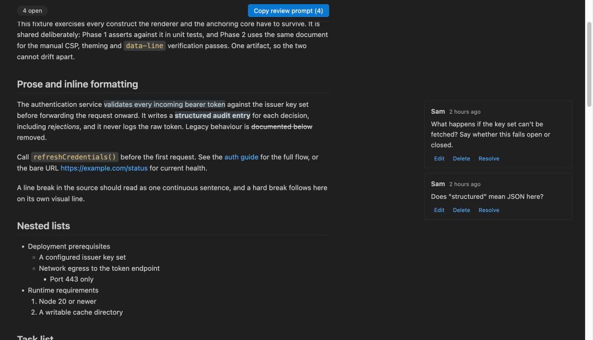
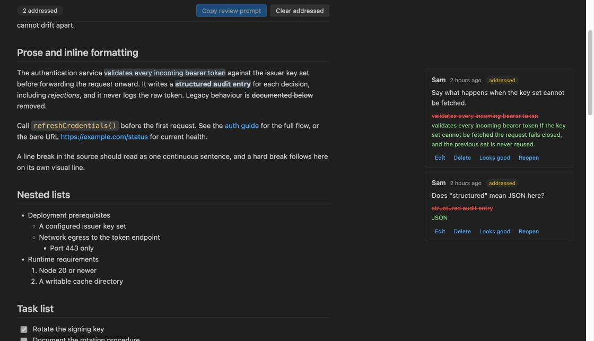
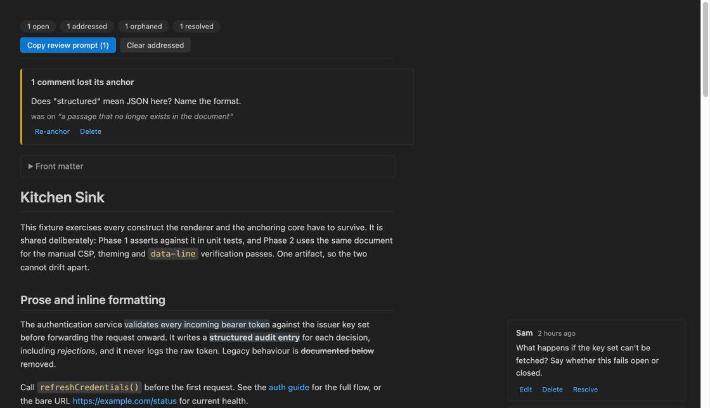

# Markdown Review

**Comment on any Markdown file like a Google Doc. Copy one prompt into any agent: no MCP server,
no setup. Your file is never modified with markers, and the pane shows which comments were addressed
and what the agent changed.**

Select a passage in a review pane and leave a comment. When you have said your piece, copy a prompt
and paste it at whichever agent you already use: Claude Code, Copilot, Cursor, Gemini, Codex. It
edits the prose; the extension works out which comments got addressed by watching the file change.

## The loop



1. **Open the review pane.** *Markdown Review: Open Review Pane*, or the button in the editor title
   bar of any Markdown file.
2. **Comment.** Select rendered text, click **Comment**, type, <kbd>Cmd</kbd>/<kbd>Ctrl</kbd>+<kbd>Enter</kbd>.
   Comments live in the margin, aligned to the passage they are anchored to.
3. **Copy the prompt** and paste it at your agent, `@`-mentioning the file. You get plain prose:

   ```
   I've left review comments on `docs/auth.md`. Please revise the document to address them.

   Edit the file directly. Don't add annotations, comments, or replies — just make the changes.
   If you disagree with a comment or need clarification, tell me instead of guessing.

   1. On: "retries failed requests up to three times"
      > Three is arbitrary here. Is it configurable? If not, say so explicitly.

   2. On the section "## Error handling"
      > This doesn't cover timeouts at all.

   3. On: "the token" (under "## Refresh", line 42)
      > Which token is this, the access token or the refresh token?
   ```

4. **Confirm.** As the agent edits, cards flip to **addressed** and show you the before and after.
   **Looks good** resolves one; **Reopen** puts it back.



The agent is never asked to write structured data, follow a schema, or preserve annotations — only
to edit prose. All the bookkeeping is this extension's job. That is the whole reason it works with
any agent at all.

## Prompt numbers

Each card from the last prompt you copied shows its item number, for example `#3`. When the agent
replies "on item 3, I changed...", you can find the card. When a quoted passage appears more than
once in the document, the prompt says where, as in item 3 above.

## Status bar and badges

A status bar item shows the active Markdown file's counts, for example `3 open · 2 to confirm`, and
opens the review pane when clicked. Reviewed files get an Explorer badge with the number of comments
needing action. Both show as soon as you open a workspace that holds `.reviews/` files, with no pane
open.

Reviews kept in global storage (`markdownReview.storageLocation` set to `global`) show these
indicators only after their review has been loaded in the current session, for example by opening
its pane. They are not scanned, because the hashed storage names cannot be mapped back to a folder
in a multi-root workspace.

## Changes since prompt

After you copy a prompt, the blocks the agent changed are marked with a bar in the margin, and the
header shows `Show changes (4)`, which opens a side-by-side diff against the version you copied.
When nothing changed it reads `No changes since prompt`. For a document too large to mark inline,
the button still opens the diff and its tooltip says why there are no marks. A document over 256 KB
of rendered text when you copy the prompt gets no baseline, so it shows neither marks nor the
button; the `Markdown Review` output channel says why.

## How detection works — and what it does not promise

`addressed` is **inferred**, by comparing the text an anchor points at against a snapshot taken when
you copied the prompt. It is a suggestion, not a verdict. You confirm it.

That means it is sometimes wrong in both directions: an agent can rewrite a sentence without
addressing the point, and it can address the point somewhere else entirely. Two consequences the
design takes seriously:

- **Nothing is ever deleted automatically.** No comment, no sidecar, ever, for any reason. Comments
  you clear are backed up first.
- **A comment that can no longer be found becomes `orphaned`, not resolved.** It moves to a triage
  section showing the text it used to point at, and you can re-anchor it to a new passage by hand.

If the whole document is replaced, every comment orphans, a banner appears, and you can diff the
snapshot against what is there now. Turn inference off entirely with
`markdownReview.autoDetectResolution` if you would rather resolve everything by hand.



Every status is a filter chip in the header, so you can narrow the pane to just what still needs
you.

## Settings

| Setting | Default | What it does |
| --- | --- | --- |
| `markdownReview.author` | *system username* | Name attached to your comments. Defaults to your system username. |
| `markdownReview.storageLocation` | `workspace` | `workspace` writes to `.reviews/` (shareable via git). `global` keeps comments private to your machine. |
| `markdownReview.autoDetectResolution` | `true` | Mark comments as addressed when their anchored text changes. |

## Where your comments live

One JSON file per reviewed document, under `.reviews/` in your workspace, named after the document
with `/` flattened to `__`:

```
docs/specs/auth.md  →  .reviews/docs__specs__auth.md.json
```

Human-readable and versioned, so it diffs and merges like anything else in the repo — commit it and
your review travels with the branch, or add `.reviews/` to `.gitignore` and keep it to yourself. If
a sidecar is ever corrupt, it is backed up to `.json.bak` and you are told, rather than silently
discarded.

Set `storageLocation` to `global` to keep sidecars out of the repo entirely.

## Privacy

**No telemetry, no network requests, no analytics. Ever.** Not opt-out — absent. The only thing that
ever leaves your machine is the prompt you copy, to the agent you chose to paste it into.

This is checked rather than promised: `scripts/check-bundles.mjs` fails the build if either shipped
bundle so much as contains `fetch(`, `XMLHttpRequest`, `WebSocket`, `sendBeacon`, `EventSource` or a
Node networking `require`.

## Not in v1

No comment threads or replies (one comment per anchor), no multi-user identity beyond a display
name, no real-time collaboration, no reactions, no editing markdown in the preview, and no MCP
server — that last one is a good v2 and is deliberately out of scope now.

## Requirements

VS Code 1.90 or later.

## License

[MIT](LICENSE).
