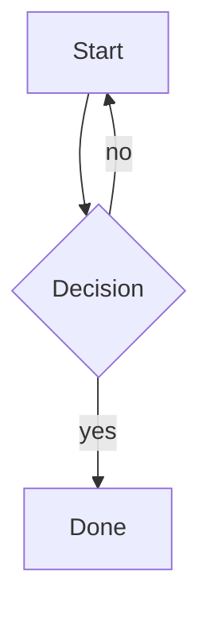
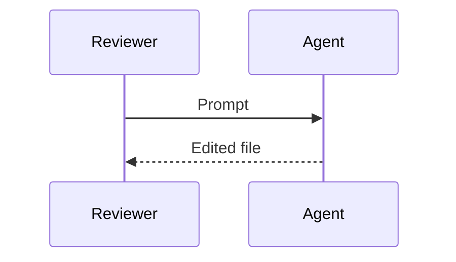

# Rich blocks

A paragraph before the callouts.

> [!NOTE]
> Notes carry extra context for the reader.

> [!TIP]
> Tips suggest a better way.

> [!IMPORTANT]
> Important information the reader needs.

> [!WARNING] Read this first
> Warnings flag something risky.

> [!CAUTION]
> First paragraph of a caution.
>
> Second paragraph of a caution.

- A list item introducing a callout.
  > [!NOTE]
  > A note inside a tight list item.
- A second list item.

## Footnotes

A claim that needs a source[^src] and a second mention of the same source[^src], plus another note[^other].

[^src]: The source, with *emphasis*.
[^other]: A second note.

The last paragraph comes after the footnote definitions.

## Diagrams

A valid flowchart:



A valid sequence diagram:



An invalid diagram:

```mermaid
graph TD
  A --> -->
```

- A list item with a diagram:

  ```mermaid
  graph LR
    X --> Y
  ```
